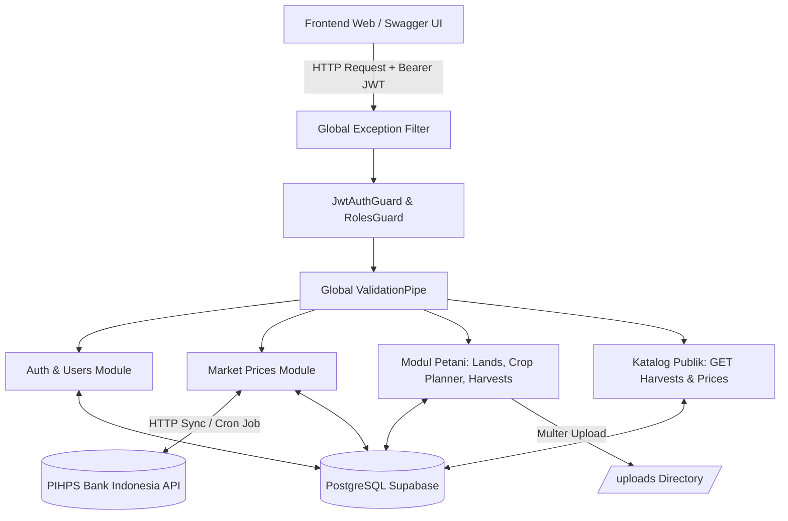
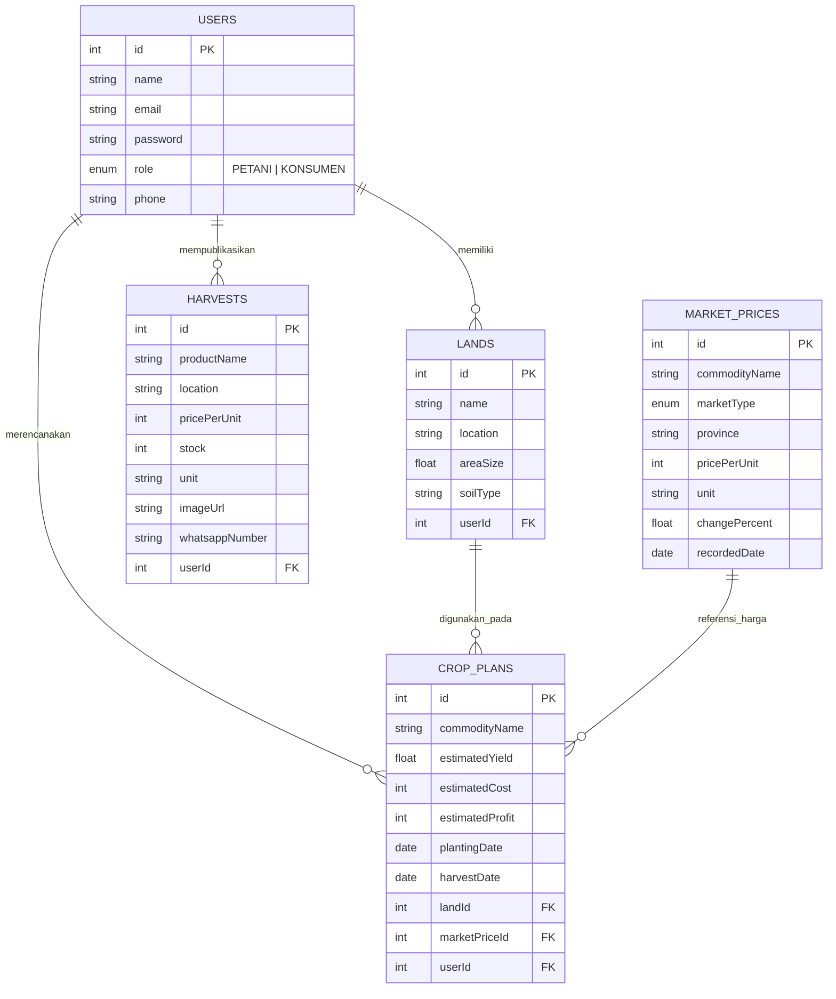

# PasarTani API (AgriDirect Backend)

> **PasarTani API** adalah layanan *backend* RESTful untuk platform *agritech* **PasarTani** yang memotong rantai distribusi pertanian dengan menghubungkan petani secara langsung ke konsumen (*Direct-to-Consumer*). Dibangun menggunakan **NestJS**, **TypeORM**, dan **PostgreSQL (Supabase)**, API ini mengelola autentikasi JWT, sistem multi-peran (*Multi-Role*), sinkronisasi harga pangan real-time dari Bank Indonesia (PIHPS), manajemen lahan pertanian, kalkulator *Smart Crop Planner*, serta katalog hasil panen.

---

## Lencana (Badges)

[](https://nestjs.com)
[](https://www.typescriptlang.org)
[](https://www.postgresql.org)
[](https://supabase.com)
[](https://typeorm.io)
[](https://jwt.io)
[](https://swagger.io)
---

## Daftar Isi (Table of Contents)

* [Deskripsi Proyek](#deskripsi-proyek)
* [Tech Stack & Arsitektur](#tech-stack--arsitektur)
* [Fitur & Penjelasan Modul Kode](#fitur--penjelasan-modul-kode)
* [Alur Kerja Sistem (System Flowchart)](#alur-kerja-sistem-system-flowchart)
* [Skema Relasi Database (ERD)](#skema-relasi-database-erd)
* [Struktur Direktori Proyek](#struktur-direktori-proyek)
* [Prasyarat / Kebutuhan Sistem (Requirements)](#prasyarat--kebutuhan-sistem-requirements)
* [Cara Instalasi & Menjalankan Server (Installation)](#cara-instalasi--menjalankan-server-installation)
* [Dokumentasi & Daftar Endpoint API](#dokumentasi--daftar-endpoint-api)
* [Panduan Pengujian di Swagger UI](#panduan-pengujian-di-swagger-ui)
* [Kontribusi (Contributing)](#kontribusi-contributing)

---

## Deskripsi Proyek

**PasarTani API** berfungsi sebagai mesin pemrosesan data (*core backend*) di balik ekosistem web **PasarTani**. Layanan ini dirancang untuk menyelesaikan permasalahan utama distribusi pangan di Indonesia:

1. **Direct-to-Consumer Backend Engine**: Menyediakan API terstruktur agar petani dapat memublikasikan stok hasil panen beserta harga dan kontak WhatsApp secara mandiri, sehingga konsumen dapat bertransaksi langsung tanpa perantara berlapis.
2. **Real-Time Commodity Price Aggregator (PIHPS BI)**: Mengintegrasikan data harga komoditas pangan harian langsung dari **PIHPS Bank Indonesia** (berdasarkan wilayah provinsi dan kategori pasar seperti *Pasar Tradisional*, *Pasar Modern*, *Pedagang Besar*, dan *Produsen*) untuk menghapus asimetri informasi harga di tingkat petani.
3. **Smart Crop Planner & Profit Simulator**: Menyediakan *engine* kalkulasi otomatis yang memproyeksikan estimasi tanggal panen, volume hasil panen, total modal tanam, dan potensi keuntungan bersih berdasarkan luas lahan serta referensi harga pasar terkini.
4. **Keamanan & Otorisasi Multi-Peran**: Menerapkan proteksi endpoint menggunakan *JSON Web Token (JWT)*, validasi payload otomatis (`ValidationPipe`), serta sistem *Switch Role* (`PETANI` / `KONSUMEN`) secara dinamis.

---

## Tech Stack & Arsitektur

* **Runtime & Language**: Node.js & TypeScript
* **Backend Framework**: NestJS v11 (Modular Architecture)
* **Database & ORM**: PostgreSQL (Supabase) & TypeORM
* **Autentikasi & Enkripsi**: `@nestjs/jwt`, `passport-jwt`, `bcrypt`
* **Validasi Data**: `class-validator` & `class-transformer`
* **Integrasi HTTP & Penjadwalan**: `@nestjs/axios` & `@nestjs/schedule` (sinkronisasi harga PIHPS Bank Indonesia)
* **Manajemen Upload File**: `multer` (penyimpanan foto komoditas hasil panen)
* **Dokumentasi Interaktif**: `@nestjs/swagger` (OpenAPI 3.0)

---

## Fitur & Penjelasan Modul Kode

Setiap folder di dalam `src/` dipisahkan berdasarkan domain bisnis agar mudah dipelihara (*maintainable*) dan diskalakan:

* **1. Auth Module (`src/auth`)**
  * Menangani registrasi pengguna baru (`POST /api/auth/register`) dengan *hashing* password menggunakan `bcrypt`, serta proses autentikasi login (`POST /api/auth/login`) yang menghasilkan `access_token` JWT.
  * Berisi `JwtStrategy` dan `JwtAuthGuard` untuk memvalidasi token pada setiap permintaan terproteksi.
* **2. Users Module (`src/users`)**
  * Mengelola entitas `User` beserta peran pengguna (`UserRole.PETANI` dan `UserRole.KONSUMEN`).
  * Menyediakan endpoint profil pengguna aktif (`GET /api/users/me`) dan fitur pergantian peran (`PATCH /api/users/role`).
* **3. Market Prices Module (`src/market-prices`)**
  * Mengelola entitas `MarketPrice` dengan enum `MarketType` (`Pasar Tradisional`, `Pasar Modern`, `Pedagang Besar`, `Produsen`).
  * Memiliki mekanisme sinkronisasi data harga pangan real-time dari **PIHPS Bank Indonesia** (`POST /api/market-prices/sync`) dan pencarian harga berdasarkan komoditas maupun provinsi.
* **4. Lands Module (`src/lands`)**
  * Mengelola entitas `Land` yang terhubung ke akun petani (nama lahan, lokasi/dusun, luas lahan dalam $m^2$, jenis tanah, dan status lahan).
* **5. Crop Planner Module (`src/crop-planner`)**
  * Mengelola entitas `CropPlan` yang menghubungkan data `Land` dengan referensi `MarketPrice` untuk menghitung simulasi hasil panen, modal tanam, dan estimasi profit.
* **6. Harvests Module (`src/harvests`)**
  * Mengelola entitas `Harvest` untuk publikasi katalog hasil panen petani lengkap dengan dukungan unggah foto (`multipart/form-data`), pembaruan stok/harga, dan filter lokasi daerah untuk konsumen.
* **7. Common & Database Module (`src/common` & `src/database`)**
  * `src/common`: Berisi *custom decorators* (`@CurrentUser()`, `@Roles()`), `RolesGuard` untuk pembatasan akses berbasis peran, dan `HttpExceptionFilter` untuk menyeragamkan format respons error JSON.
  * `src/database`: Mengatur konfigurasi koneksi TypeORM ke PostgreSQL Supabase serta skrip `seed.ts` untuk pengisian data awal.

---

## Alur Kerja Sistem (System Flowchart)



---

## Skema Relasi Database (ERD)



---

## Struktur Direktori Proyek

```text
agridirect-api/
├── src/
│   ├── auth/                  # Modul registrasi, login, JwtStrategy & JwtAuthGuard
│   ├── common/                # Decorators (@CurrentUser, @Roles), RolesGuard & Exception Filter
│   ├── crop-planner/          # Modul kalkulasi simulasi tanam & estimasi profit
│   ├── database/              # Konfigurasi koneksi TypeORM & seed.ts
│   ├── harvests/              # Modul manajemen katalog panen & upload foto (Multer)
│   ├── lands/                 # Modul CRUD data lahan pertanian petani
│   ├── market-prices/         # Modul harga komoditas pangan & integrasi PIHPS BI
│   ├── users/                 # Modul profil pengguna & switch role (PETANI / KONSUMEN)
│   ├── app.module.ts          # Root module & registrasi seluruh modul aplikasi
│   └── main.ts                # Entry point server, global prefix (/api), CORS & Swagger
├── uploads/                   # Direktori penyimpanan lokal foto hasil panen
├── .env                       # Konfigurasi environment variables (tidak di-push ke Git)
├── .gitignore                 # Daftar file/folder yang diabaikan Git
├── package.json               # Daftar dependensi dan skrip NPM
└── tsconfig.json              # Konfigurasi compiler TypeScript
```

---

## Prasyarat / Kebutuhan Sistem (Requirements)

Sebelum menjalankan backend secara lokal, pastikan lingkungan pengembangan Anda memenuhi spesifikasi berikut:

* **Node.js**: Versi `18.x` atau `20.x+`
* **Package Manager**: `npm` (v9.x+)
* **Database**: Instance PostgreSQL aktif (direkomendasikan menggunakan **Supabase** dengan *Connection Pooler URL*)
* **Akses Internet**: Diperlukan untuk koneksi ke database Supabase dan penarikan data harga dari API PIHPS Bank Indonesia

---

## Cara Instalasi & Menjalankan Server (Installation)

1. **Clone Repositori**
   ```bash
   git clone [https://github.com/username-kamu/agridirect-api.git](https://github.com/username-kamu/agridirect-api.git)
   cd agridirect-api
   ```

2. **Install Dependensi**
   ```bash
   npm install
   ```

3. **Konfigurasi Environment Variables**
   Buat berkas `.env` pada direktori root proyek dan sesuaikan dengan kredensial database Supabase serta secret JWT Anda:
   ```env
   PORT=3000
   DATABASE_URL=postgresql://postgres.[PROJECT-REF]:[PASSWORD]@[aws-0-ap-southeast-1.pooler.supabase.com:6543/postgres](https://aws-0-ap-southeast-1.pooler.supabase.com:6543/postgres)
   JWT_SECRET=rahasia_jwt_pasartani_2026
   JWT_EXPIRES_IN=7d
   ```

4. **Jalankan Server**
   ```bash
   # Mode development (dengan auto-reload saat kode diubah)
   npm run start:dev

   # Build & jalankan mode produksi
   npm run build
   npm run start:prod
   ```

5. **Verifikasi Server Berjalan**
   Setelah server menyala tanpa error, akses dokumentasi interaktif Swagger di browser:
   ```text
   http://localhost:3000/api/docs
   ```

---

## Dokumentasi & Daftar Endpoint API

Semua endpoint menggunakan prefix global `/api`. Endpoint bertanda 🔒 membutuhkan header `Authorization: Bearer <access_token>`.

| Modul | Method | Endpoint | Akses | Deskripsi |
| :--- | :--- | :--- | :--- | :--- |
| **Auth** | `POST` | `/api/auth/register` | Publik | Mendaftarkan akun pengguna baru |
| **Auth** | `POST` | `/api/auth/login` | Publik | Login dan mendapatkan `access_token` JWT |
| **Users** | `GET` | `/api/users/me` | 🔒 Login | Mengambil detail profil pengguna yang sedang login |
| **Users** | `PATCH` | `/api/users/role` | 🔒 Login | Memilih atau mengganti peran (`PETANI` / `KONSUMEN`) |
| **Market Prices** | `GET` | `/api/market-prices` | Publik | Menampilkan daftar harga komoditas pangan terkini |
| **Market Prices** | `POST` | `/api/market-prices/sync` | 🔒 Login | Sinkronisasi data harga pangan terbaru dari PIHPS BI |
| **Lands** | `GET` | `/api/lands` | 🔒 Petani | Menampilkan semua lahan milik petani yang login |
| **Lands** | `POST` | `/api/lands` | 🔒 Petani | Menambahkan data lahan pertanian baru |
| **Crop Planner** | `GET` | `/api/crop-planner` | 🔒 Petani | Melihat daftar rencana tanam & simulasi petani |
| **Crop Planner** | `POST` | `/api/crop-planner` | 🔒 Petani | Membuat simulasi & menyimpan rencana tanam baru |
| **Harvests** | `GET` | `/api/harvests` | Publik | Menampilkan katalog hasil panen yang tersedia |
| **Harvests** | `POST` | `/api/harvests` | 🔒 Petani | Memposting komoditas hasil panen baru (dengan foto) |

---

## Panduan Pengujian di Swagger UI

1. Buka `http://localhost:3000/api/docs` setelah server berjalan.
2. Jalankan **`POST /api/auth/register`** atau **`POST /api/auth/login`**, lalu salin string `access_token` dari respons JSON.
3. Klik tombol **Authorize** (ikon gembok hijau di kanan atas Swagger), tempel `access_token` ke kolom **Value**, lalu klik **Authorize**.
4. Jalankan **`PATCH /api/users/role`** dengan body `{"role": "PETANI"}` untuk mengaktifkan akses fitur petani.
5. Jalankan **`POST /api/market-prices/sync`** untuk mengisi data harga komoditas dari PIHPS Bank Indonesia.
6. Uji fitur utama secara berurutan: **`POST /api/lands`** -> **`POST /api/crop-planner`** -> **`POST /api/harvests`**.

---

## Kontribusi (Contributing)

Kontribusi untuk pengembangan **PasarTani API** sangat terbuka:

1. **Fork** repositori ini.
2. Buat *feature branch* baru (`git checkout -b feature/NamaFitur`).
3. Simpan perubahan Anda (`git commit -m "Menambahkan fitur baru"`).
4. Push ke branch tersebut (`git push origin feature/NamaFitur`).
5. Buat **Pull Request** baru menuju branch `main`.

---

*Dikembangkan sebagai Backend Service untuk Ketahanan Pangan & Agritech Indonesia 🇮🇩*
